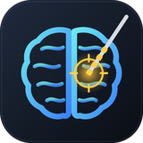

# brainscope

Desktop app for coregistering a CT to an MRI and localizing the contacts of intracranial leads (SEEG, DBS and
other linear leads), for humans and animals (e.g. pigs). NIfTI or DICOM in; contact coordinates in the MRI space
out, as a BIDS-style `electrodes.tsv`.

**Research use only. Not for clinical decisions.**

Status: first working version (0.1.0). Validated on synthetic data with known ground truth (below); not yet
validated on real scans. The plan and design decisions are in [docs/PLAN.md](docs/PLAN.md).

## Getting the app

Installers (Windows `-setup.exe` or portable `.zip`; macOS `.dmg` for Apple silicon) are attached to
the [Releases](https://github.com/xmival00/brainscope/releases). They are **not code-signed**, so confirm the first
start:

- **Windows:** "Windows protected your PC" → *More info* → *Run anyway*.
- **macOS:** open the app once and close the warning, then *System Settings → Privacy & Security* → *Open Anyway*.
  If macOS says the app "is damaged", run `xattr -dr com.apple.quarantine /Applications/brainscope.app`.

From source (Python 3.11+):

```bash
pip install ".[desktop]"
brainscope            # opens the app window (or: brainscope app --browser)
```

Projects are stored in `~/brainscope-projects` (change with `brainscope app --projects DIR`).

## Workflow

1. **Import** the MRI and the CT: image files (NIfTI `.nii`/`.nii.gz`, MGZ/MGH, NRRD, MHA/MHD; other formats
   are converted to NIfTI on import) or DICOM folders (converted inside the app with dcm2niix, or with SimpleITK
   if dcm2niix cannot run; sidecars are anonymized). Choose the species (sets the registration smoothing).
2. **Orient** each scan separately: rotate by 90° in the sagittal, coronal or axial view and mirror until the
   head is upright, the nose points forward and the subject's left is on the screen left (neurological view).
   Confirm which side is left (e.g. from the CT marker). Only the header changes; voxels are never resampled.
3. **Coregister** the CT to the MRI. If the scanners' coordinates differ or the CT covers more than the head, first
   click the same landmark in both scans (*rough alignment*); the automatic step then starts from there. Put a
   *region-of-interest* box around the brain so the body and loose soft tissue are ignored. The CT is
   overlaid from the start; set the display window of either scan in the viewer bar; *Center* finds the image (rigid, mutual information). For pigs, optionally restrict it to a box around
   the brain. Check with the CT overlay, adjust by hand if needed, accept.
4. **Leads**: for each lead, put the crosshair on its deepest end and press <kbd>T</kbd>, on a point further
   along it and press <kbd>E</kbd>, pick the lead preset and press *Detect contacts*. The app then works in
   planes perpendicular to the lead, in stages:
   - it follows the metal plane by plane to refine the lead's axis (straight, or curved as an option), ignoring
     bone;
   - it straightens the lead and fits the preset's contact pattern to the intensity profile along it;
   - it refines each contact where the CT separates them, otherwise it places them from the preset geometry
     (marked `geometry`).
   
   The inspector shows two lengthwise views of the straightened lead, the profile with the fitted model, and
   the perpendicular plane under the mouse. Drag a contact to move it, shift all contacts, or keep one contact
   and fit the others to it.
5. **Export** the contacts table and, optionally, the coregistered volumes. Save and load results files. If
   something goes wrong, *Make debug bundle* writes a small zip (scans at about 2 mm, the CT around each lead,
   the project state without file names) that can be shared instead of the full scans.

*Demo case* (top bar) builds a synthetic pig-like case: wrong orientation headers to fix, a CT marker on the
left, three leads, and a CT misaligned to the MRI.

## Outputs

All coordinates are **world coordinates (RAS+, mm) of the orientation-corrected MRI**.

| File | Content |
|---|---|
| `sub-01_electrodes.tsv` | one row per contact: BIDS columns `name x y z size group type material manufacturer hemisphere`, then `lead contact_index`, MRI voxel `mri_i mri_j mri_k`, orientation-corrected CT world `ct_x ct_y ct_z`, `fit_mode` (`fitted`, `geometry`, `manual`) and `confidence` (0 to 1). `size` is the contact surface in mm². |
| `sub-01_coordsystem.json` | the coordinate system, the MRI file it refers to (SHA-256) and its corrected affine |
| `sub-01_leads.brainscope.json` | the results file: leads, presets, axes and contacts; load it again in *Export → Load results* |
| `ct_to_mri_ras.txt` | 4×4: orientation-corrected CT world → MRI world (RAS mm) |
| `ct_raw_to_mri_ras.txt` | 4×4: CT world as in the CT file's header → MRI world |
| `mri_to_ct_itk.tfm` | ITK transform (LPS) for resampling the corrected CT onto the MRI |
| `sub-01_mri_corrected.nii.gz` | optional: the MRI with the corrected header (voxels unchanged) |
| `sub-01_ct_in_mri.nii.gz` | optional: the CT resampled onto the MRI grid |
| `sub-01_contacts.nii.gz` + `_contacts_labels.tsv` | optional: a label volume with one ball per contact |

## Lead presets

A preset describes a lead model: number of contacts, contact length, diameter, center-to-center spacing (one
value, or one per gap for irregular leads), distance from the tip to the first contact, label pattern (e.g.
`{lead}{n}`) and the number of the deepest contact. Built-in presets (generic, DIXI Microdeep D08, Medtronic
3387/3389) are read-only and must be checked against the manufacturer's datasheet; edit copies or new presets in
*Leads → Presets…*. User presets are JSON files in the app-data folder (`%APPDATA%\brainscope\presets`,
`~/Library/Application Support/brainscope/presets`, `~/.local/share/brainscope/presets`). A project keeps a copy
of each preset it used, so later edits never change old results.

## Accuracy on synthetic data

| Check (tests in `tests/`) | Result |
|---|---|
| Contacts separate on the CT (DIXI-like, 0.5 mm voxels, rough clicks ±1.5 mm) | < 0.25 mm |
| Anisotropic CT (0.45 × 0.45 × 0.8 mm) | < 0.3 mm |
| DBS-like contacts merged on the CT (placed from geometry) | < 0.4 mm |
| Coregistration, demo case, error at the contacts | mean 0.3 mm, max 0.5 mm |
| Full workflow, demo case (orientation fix, coregistration, three leads) | < 1 mm for all 22 contacts |

Real scans will be harder (metal artifacts, motion, real anatomy); validation on real data is the next step.

## Command line

```bash
brainscope demo DIR                       # write the synthetic demo case
brainscope info FILE.nii.gz               # geometry of a NIfTI
brainscope dicom DICOM_DIR OUT_DIR        # DICOM to NIfTI
brainscope coreg --ct CT --mri MRI --out ct_to_mri.txt [--species pig]
brainscope detect --ct CT --tip X Y Z --entry X Y Z --preset dixi-microdeep-d08-10
brainscope debug-bundle PROJECT_DIR       # small zip to share when something goes wrong
brainscope selftest
```

The app's engine is also an HTTP API on `127.0.0.1` (see `src/brainscope/server.py`), so the same UI and engine
can later be embedded in a web dashboard.

## Development

```bash
python -m venv .venv && . .venv/bin/activate
pip install -e ".[dev,desktop]"
python -m pytest                         # about 2 minutes
brainscope app --browser                 # UI in the default browser
```

Installers: *Actions → installers → Run workflow* builds and self-tests them without storing anything; pushing a
tag `v*` (or a manual run with a tag name in "release") creates a draft pre-release, uploads the installers to it
and publishes it when all platforms passed. Third-party licenses: [THIRD_PARTY_NOTICES.md](THIRD_PARTY_NOTICES.md).
